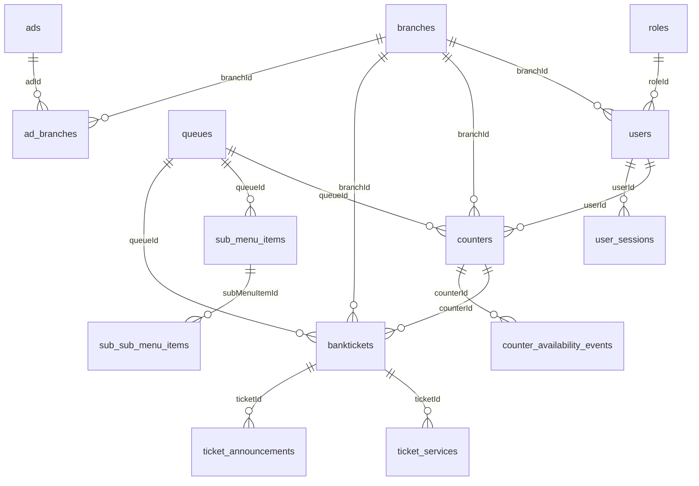
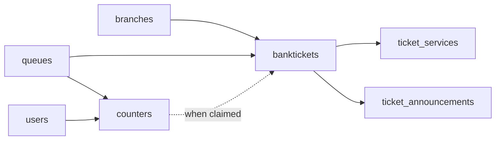
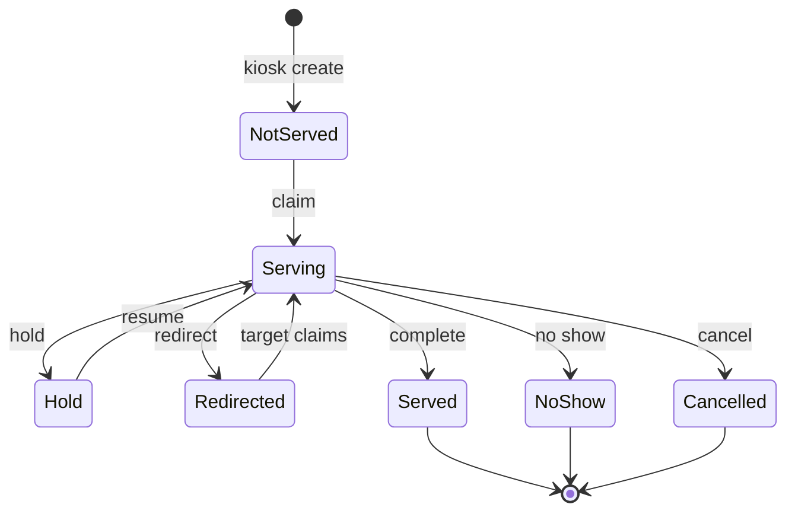

# Database guide

This document describes the SQL Server schema used by **Q Simplified** (QMS Angular), as defined in [`src/server/db/schema.ts`](../src/server/db/schema.ts).

IDs are string UUIDs (`nvarchar`). Foreign keys are **logical** (enforced in the BFF), not always declared as SQL constraints in Drizzle.

---

## Contents

- [Entity overview](#entity-overview)
- [Table reference](#table-reference)
- [Relationships](#relationships)
- [Serving tickets — lifecycle](#serving-tickets--lifecycle)
- [Usage scenarios](#usage-scenarios)
- [Indexes worth knowing](#indexes-worth-knowing)

---

## Entity overview

---

## Table reference

### Organization & access

| Table | Purpose |
|-------|---------|
| **`settings`** | Single-tenant company profile: name, contact, logo, timezone preference, admin password, notification text. |
| **`branches`** | Physical locations. Holds kiosk and hall-display credentials, optional network/DB fields, active flag. |
| **`roles`** | Named permission sets (JSON string in `permissions`). |
| **`users`** | Staff accounts. Linked to `roleId` + `branchId`. `activeSessionToken` enforces single active dashboard/serving login. |

### Service catalog

| Table | Purpose |
|-------|---------|
| **`queues`** | Top-level service lines (e.g. Tellering, Accounts). |
| **`sub_menu_items`** | Services under a queue; `priority` affects claim ordering. |
| **`sub_sub_menu_items`** | Nested services under a sub-menu item. |

Kiosk navigation and ticket `issueDescription` / category fields derive from this tree.

### Day-to-day operations

| Table | Purpose |
|-------|---------|
| **`counters`** | A teller’s desk assignment for **today**: `counterNumber`, `queueId`, optional sub-item filters, `available` flag. Scoped by `createdAt` to the EAT calendar day. |
| **`banktickets`** | The customer ticket: number, status, durations, rating, phone, language, multi-tx JSON, current counter/service pointers. |
| **`ticket_services`** | Ordered **segments** of a ticket’s life (wait, serve, hold, redirect). One open segment at a time (`endedAt` null). |
| **`counter_availability_events`** | Timeline of `AVAILABLE` / `PAUSED` for a counter (reports, utilization). |
| **`ticket_announcements`** | Hall audio queue: `initial`, `call_again`, hold/redirect resume types; status `queued` → playing → done/error. |

### Displays & marketing

| Table | Purpose |
|-------|---------|
| **`ads`** | Image / video / YouTube creatives with optional validity window and `isLive`. |
| **`ad_branches`** | Many-to-many: which branches show which ads. |
| **`announcements`** | Scrolling text on hall/kiosk. |
| **`announcement_types`** | Colors/styles for announcement kinds. |
| **`social_media`** | Handles shown on displays. |
| **`exchange_rates`** | Forex board (buying/selling, `displayOrder`). |

### Audit & sessions

| Table | Purpose |
|-------|---------|
| **`logs`** | Lightweight login/action notes. |
| **`user_sessions`** | Opened/closed actor sessions (`dashboard`, `serving`, etc.) with start/end reasons. |
| **`audit_logs`** | Structured before/after + metadata for config and serving actions. |

---

## Relationships

### Who owns a ticket?

- A ticket always belongs to a **branch** and a **queue** (plus optional sub/sub-sub item).
- `counterId` is set when an agent claims or is assigned the ticket.
- `currentServiceId` points at the active row in `ticket_services`.

### Counter ≠ permanent desk

`counters` rows are **daily instances**, not permanent fixtures:

- Same physical window “3” → new row each EAT day.
- Uniqueness of `counterNumber` is enforced in the API for `(branchId, counterNumber, today)`.
- Listing/claiming filters use `todayRange()` so yesterday’s counters disappear automatically.

---

## Serving tickets — lifecycle

### Status values

From `src/server/ticketStatus.ts`:

| Status | Meaning |
|--------|---------|
| `Not Served` | Waiting in queue |
| `Serving` | At a counter now |
| `Hold` | Parking; can resume |
| `Redirected` | Sent to another counter (pending accept) |
| `Served` | Completed |
| `No Show` | Called but customer absent |
| `Cancelled` | Abandoned / cancelled |

### Segment model (`ticket_services`)

Each status stretch is a **segment** with `sequence`, `startedAt`, optional `endedAt`, `duration`, `endReason`, and optional redirect from/to counters.

### Hall announcements

When a ticket is claimed (or call-again / resume), the BFF inserts `ticket_announcements`. The hall display polls, plays audio clips for `ticketNo` + counter, then marks the announcement complete.

---

## Usage scenarios

### 1. Issue a ticket (kiosk)

1. Customer picks queue → optional sub/sub-sub → language → optional phone.
2. API creates `banktickets` with status **`Not Served`**, generates today’s `ticketNo`.
3. Opens first `ticket_services` wait segment (`openInitialWaitSegment`).
4. If phone present → deferred **VMS SMS** with ticket + queue position.

**Tables:** `banktickets`, `ticket_services`, `queues` (+ menu tables), `settings`/`branches` (SMS footer).

### 2. Agent opens a counter (serving)

1. Teller logs in → `user_sessions` + iron `auth-session` (expires EAT end of day).
2. Chooses **counter number** + primary **queue** (must be free **today** at that branch).
3. Insert `counters` + `counter_availability_events` (`AVAILABLE`).
4. Session patched with `counterId`.

**Tables:** `counters`, `counter_availability_events`, `user_sessions`, `users`.

### 3. Claim next customer

1. `findClaimableTicket`: prefer pending redirects for this counter, else oldest matching **Not Served** for today (queue/sub-item rules, priority).
2. Transition to **`Serving`**; close wait segment; open serving segment (`endReason: claimed`).
3. Queue **`ticket_announcements`** (`initial`) for hall audio.

**Tables:** `banktickets`, `ticket_services`, `ticket_announcements`, `counters`.

### 4. Hold

1. Status → **`Hold`**; serving segment ends (`held`); hold segment starts; optional `holdComment`.
2. Later resume → **`Serving`** again (`resumed`); may announce on hall.

**Tables:** `banktickets`, `ticket_services`, optionally `ticket_announcements`.

### 5. Redirect to another counter

1. Status → **`Redirected`**; `pendingRedirectAcceptance`; segment records `redirectedFromCounterId` / `redirectedToCounterId`.
2. Target agent’s next claim picks up the redirected ticket first.
3. Acceptance → **`Serving`** on the new counter; hall may announce.

**Tables:** `banktickets`, `ticket_services`, `ticket_announcements`, `counters`.

### 6. Complete / no-show / cancel

1. Status → **`Served`**, **`No Show`**, or **`Cancelled`**.
2. Open `ticket_services` segment closed; duration fields on `banktickets` updated.
3. On **Served** + phone + feedback URL → SMS with `/rating/:ticketId`.

**Tables:** `banktickets`, `ticket_services`; SMS uses `settings` + `branches` for sender line.

### 7. Customer rates service

**Walk-up:** `/feedback/login` → branch → search today’s `ticketNo` → write `rating` / `ratingComment` (once).

**SMS link:** `/rating/:id` loads ticket by id and submits the same fields.

**Tables:** `banktickets` only (rating columns). Search is constrained to **today** + branch.

### 8. Pause counter

Teller toggles availability → `counters.available` + `counter_availability_events` (`PAUSED` / `AVAILABLE`). Affects “available counters” lists and reports, not historical tickets.

---

## Indexes worth knowing

These support the hottest serving queries:

| Table | Index (approx.) | Why |
|-------|-----------------|-----|
| `banktickets` | `(branchId, ticketStatus, createdAt)` | Today’s queue by status |
| `banktickets` | `(counterId, ticketStatus, createdAt)` | Desk workload |
| `ticket_services` | `(ticketId, sequence)` unique | Ordered history |
| `ticket_services` | `(counterId, ticketStatus, endedAt)` | Segment stats |
| `ticket_announcements` | `status`, `queuedAt`, `(ticketId, attemptNumber)` | Hall playback queue |
| `counters` | sub-item indexes | Category filters |
| `users` | `activeSessionToken` | Single-session enforcement |

---

## Related files

| Concern | File |
|---------|------|
| Schema | `src/server/db/schema.ts` |
| Status / end reasons | `src/server/ticketStatus.ts` |
| Create / number gen | `src/server/tickets.ts` |
| Transitions / segments | `src/server/ticketService.ts` |
| Day boundaries (EAT) | `src/server/timezone.ts` |
| HTTP API | `src/server/api/index.ts` |
